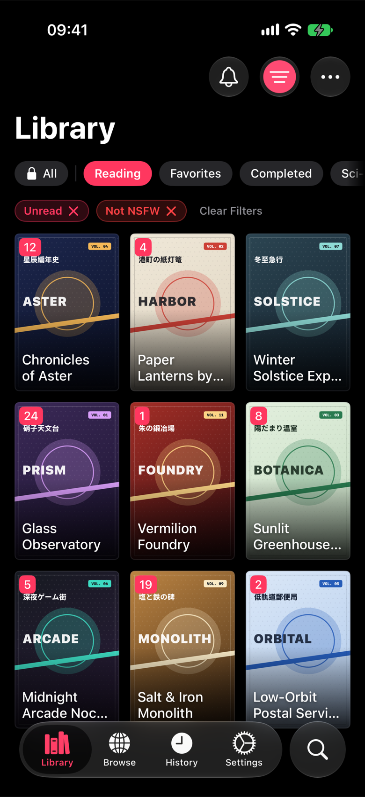
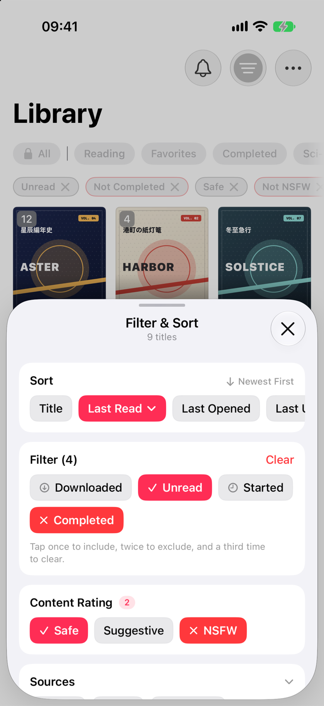
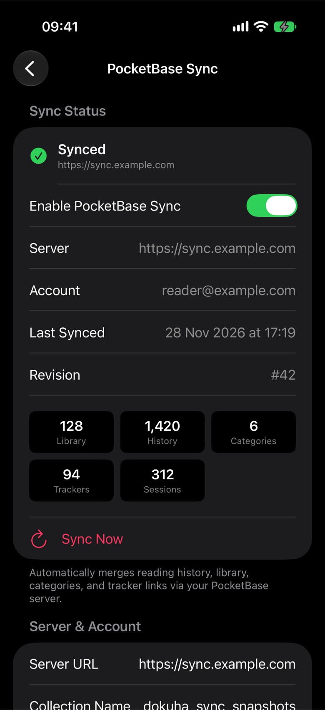
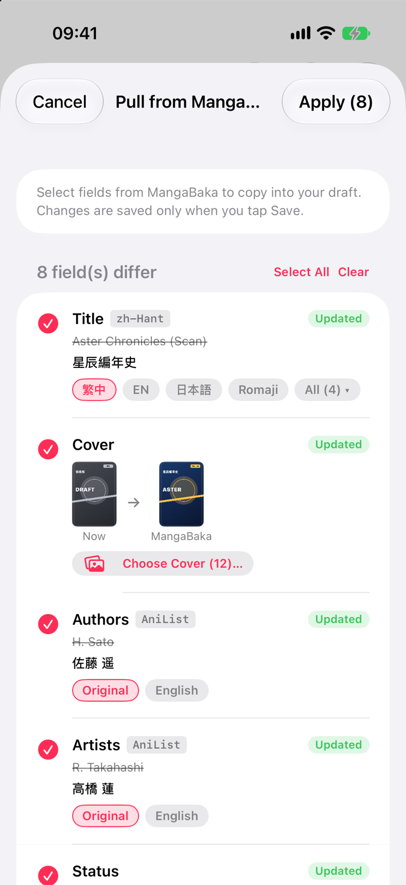

<p align="center">
  <picture>
    <source media="(prefers-color-scheme: dark)" srcset="Aidoku/App/Resources/AppIcon.icon/Assets/dark.png">
    
  </picture>
</p>

<h1 align="center">Dokuha</h1>

<p align="center">
  Personal fork of <a href="https://github.com/Aidoku/Aidoku">Aidoku</a> (<code>io.github.sfai05.Dokuha</code>) built for <strong>free Apple ID / SideStore sideloading</strong>, <strong>self-hostable PocketBase cross-device sync</strong>, <strong>richer metadata management</strong>, and <strong>one-tap library filtering &amp; navigation</strong>.
</p>

<p align="center">
  
  
  
  
</p>

---

## What's Different from Aidoku

### TL;DR

- **Free Apple ID & SideStore Ready:** Compiles and runs on a Personal Team with automated unsigned `.ipa` releases and a SideStore/AltStore `apps.json` feed.
- **Self-Hostable PocketBase Sync:** Replaces CloudKit with an inspectable snapshot + smart-merge engine, Keychain-backed auth, 60s default debounce, and foreground/background flush.
- **Sync Dashboard & Recovery Tools:** Adds a dedicated PocketBase Sync dashboard, One-Time Setup Wizard, `pb_schema.json` import, sync logs viewer, and rollback/force-sync tools.
- **Metadata Editing & MangaBaka Pull:** Edit manga fields in-app with sync-preserved `EditedKeys`, or selectively pull multi-language titles/synopses, AniList native staff, and volume covers.
- **Hardened MangaBaka Tracking:** Adds long-lived Personal Access Token (`mb-...`) auth alongside stabilized OAuth refresh, decimal progress/score decoding, and `POST` 404 fallback.
- **Redesigned Library Controls:** Replaces the dropdown with a one-tap scrollable category pill bar, adds a Filter & Sort sheet/popover with tri-state filters and active filter chips, and strengthens cover title contrast.

### Free Apple ID & SideStore / AltStore First

- Removes paid Apple Developer entitlements (`aps-environment`, iCloud/CloudKit/Ubiquity containers, `com.apple.developer.user-fonts`) and removes `remote-notification` from `UIBackgroundModes` in `Info.plist` so builds sign, install, and run cleanly under a free Apple ID (Personal Team).
- Preserves local notifications (`UNUserNotificationCenter`) and background library refresh (`BGProcessingTask` and `fetch`) without requiring APNs.
- Publishes unsigned `.ipa` builds and updates a SideStore / AltStore-compatible `apps.json` feed automatically through an isolated fork release workflow ([`.github/workflows/fork-release.yml`](.github/workflows/fork-release.yml)).

### Self-Hostable PocketBase Cross-Device Sync

- Replaces iCloud / CloudKit (`NSPersistentCloudKitContainer`) with an open, inspectable **PocketBase Sync Engine** behind a `SyncStorageProvider` protocol abstraction.
- Wraps Aidoku's backup payload in gzip-compressed `SyncEnvelope` snapshots with optimistic `revision` locking, SHA-256 checksum verification, lightweight deletion tombstones, and a non-destructive background smart merge (newest `dateRead` wins for reading history; union + tombstone reconciliation for library entries, categories, tracker links, and `EditedKeys`).
- Runs quietly with battery-friendly triggers: 60-second default change debounce (configurable from `5` to `120` seconds), automatic pull when returning to the foreground, lock-screen / background `UIBackgroundTask` flush, and pending-state flush on termination.
- Uses security-first defaults: daily sync signs in with a regular PocketBase `users` account stored strictly in iOS Keychain, enforces owner-scoped API rules (`@request.auth.id != "" && owner = @request.auth.id`), keeps safe app settings sync off by default, and strips sensitive keys (`login`, `password`, `token`, `auth`, `cookie`) even when enabled.

### Sync Dashboard, Setup Wizard & Recovery Tools

- Replaces the single iCloud Sync switch with a dedicated **Settings → PocketBase Sync** dashboard featuring a Green / Yellow / Red status indicator, synced entity counts (Library, History, Categories, Trackers, Sessions), revision counter, and manual **Sync Now**.
- Includes a **One-Time Setup Wizard** that creates or validates the PocketBase sync collection using transient Superuser credentials kept strictly in memory and immediately discarded, alongside a **Manual `pb_schema.json` Import** sheet ([`docs/sync/pb_schema.json`](docs/sync/pb_schema.json)) for least-privilege or shared servers.
- Adds a filterable, copyable, exportable **Sync Logs** viewer and **Experimental & Recovery** controls for Force Sync, Force Push, Force Pull Latest, historical snapshot rollback, stale snapshot cleanup (configurable `2`–`50` snapshots retained), and local sync cursor reset.

### In-App Metadata Editing & MangaBaka Pull

- Adds an in-app **Edit Metadata** editor (accessible from the `…` menu for bookmarked and local manga) covering Cover (photo picker, remote URL, or source reset), Title, Authors, Artists, Publishing Status, Content Rating, Description, and Tags — with per-field edit locks (`EditedKeys`) preserved across PocketBase sync and per-field or full reset to source defaults.
- Adds a selective **Pull from MangaBaka** diff sheet for MangaBaka-tracked series:
  - Multi-language title and synopsis pickers combining MangaBaka, MangaDex, and Bangumi (including automatic Simplified-to-Traditional Chinese conversion for Bangumi descriptions), ranked by a local-only **Title Language Priority** order.
  - Original-script vs. English author and artist switcher powered by AniList.
  - Browsable volume and artwork cover gallery via MangaBaka `/images`, plus Content Rating mapping.
- *Privacy note:* User-initiated **Pull from MangaBaka** actions query public, unauthenticated AniList, MangaDex, and Bangumi endpoints using only the tracked series ID or title solely to enrich staff names and localized synopses; no user credentials or personal data are sent.

### Hardened MangaBaka Tracking & Personal Access Token (PAT) Auth

- Adds long-lived **Personal Access Token (`mb-...` via `x-api-key`)** authentication stored in iOS Keychain and verified via `/v1/my/profile`, complete with scope checks and non-destructive switching between PAT and OAuth that keeps existing tracked manga links intact.
- Hardens OAuth refresh behavior (RFC 3986 form encoding, concurrent refresh coalescing, and token preservation on transient errors) and fixes decimal chapter/volume/rating decoding, remote `404` fallback with `POST` auto-create, `en_US_POSIX` `YYYY-MM-DD` date parsing/formatting, and `finish_date` encoding.

### Redesigned Library Navigation, Filter & Sort

- **One-Tap Category Pill Bar:** Replaces the two-tap `All ▾` dropdown with an edge-to-edge horizontally scrollable capsule bar featuring dynamic horizontal scroll edge fade, category lock icons, distinct Filter Group pill styling, and automatic scroll-to-selection. Removes the redundant in-library search bar in favor of the dedicated Search tab.
- **Dedicated Filter & Sort Sheet:** Adds a top-bar Filter & Sort button opening a grouped-card SwiftUI sheet on iPhone (and an anchored popover on regular-width iPad) with live matching title count, a single-row horizontal Sort bar, tri-state Filter pills (include / exclude / clear), direct Content Rating pills, and expandable Sources & Categories cards.
- **Active Filter Chips & Visual Polish:** Adds a non-overlapping active filter chips strip with horizontal scroll edge fade stacked below the category bar, a one-tap `Clear Filters` empty-state button, contrast-aware selected foregrounds, a strengthened multi-stop cover title scrim for bright cover artwork, safe-area-centered empty/locked state views, and iOS 26 floating tab bar bottom clearance.

### Minimal, Isolated Fork Architecture

- Keeps upstream file edits to thin delegation hooks while placing fork code in dedicated folders (`Aidoku/Core/Sync/`, `Aidoku/Features/Settings/Sync/`, `Aidoku/Core/Metadata/`, `Aidoku/Features/Manga/Metadata/`, `Aidoku/Features/Library/Fork/`, `Aidoku/Core/Tracking/Fork/`, `Aidoku/Features/Settings/Tracking/`), separate `ForkLocalizable.strings` (`en` / `zh-Hant`), dedicated `ForkSync.` / `Fork.` `UserDefaults` prefixes, isolated fork CI workflows (`fork-release.yml`, `fork-lint.yml`), and zero edits to `Aidoku.xcdatamodeld`.

### Installing Dokuha

1. **SideStore (recommended) or AltStore:** Open **Sources**, tap **+**, and add:
   ```
   https://raw.githubusercontent.com/sfai05/Aidoku/altstore/apps.json
   ```
   Install **Dokuha** or update in place whenever new builds are published.
2. **Manual IPA:** Download the latest unsigned `.ipa` from [GitHub Releases](https://github.com/sfai05/Aidoku/releases) and sideload it with SideStore or AltStore.
3. **Build from Source (Free Apple ID):** Copy [`Local.xcconfig.example`](Local.xcconfig.example) to `Local.xcconfig`, set `DEVELOPMENT_TEAM` to your Personal Team ID (plus optional `APP_DISPLAY_NAME`, `APP_ID_PREFIX`, and `APP_ID_SUFFIX` overrides), and build the `Aidoku` scheme in Xcode without modifying `project.pbxproj`.
4. **Set Up Cross-Device Sync:** Open **Settings → PocketBase Sync**, enter your PocketBase server URL, create the collection with the **One-Time Setup Wizard** (or import [`docs/sync/pb_schema.json`](docs/sync/pb_schema.json) in PocketBase Admin UI `/_/`), and sign in with a regular PocketBase **`users`** account on each device.

> **Sync scope:** Sync transfers your library, custom manga metadata edits, reading history, chapters, categories, tracking links, reading sessions, updates, vocabulary, custom source configs, and source list URLs. Safe app settings sync is **off by default** (and sensitive keys matching `login`, `password`, `token`, `auth`, or `cookie` are always stripped). External `.aix` sources and offline chapter downloads are installed per device.

---

## What is Aidoku?

[Aidoku](https://github.com/Aidoku/Aidoku) is a free and open-source manga reading application for iOS, iPadOS, and macOS created by [Skittyblock](https://github.com/Skittyblock) and contributors. Dokuha is built directly on top of Aidoku's core reader, database, and source ecosystem.

<p align="center">
  
  
  
</p>

### Core Aidoku Features

- No ads
- Local file reading (CBZ / CBR)
- Built-in reading service providers (Komga, Kavita, Suwayomi)
- WASM external source system
- Offline chapter downloads
- Tracker integration (AniList, MyAnimeList, MangaBaka, Bangumi, Shikimori, etc.)
- OCR dictionary lookup

### Upstream Links & Licensing

- **Website & Docs:** [aidoku.app](https://aidoku.app)
- **Community & TestFlight:** [Aidoku Discord](https://discord.gg/kh2PYT8V8d)
- **Upstream Releases:** [Aidoku/Aidoku Releases](https://github.com/Aidoku/Aidoku/releases)
- **Translations:** Crowdsourced on [Weblate](https://hosted.weblate.org/engage/aidoku/) and licensed separately under [Apache 2.0](https://spdx.org/licenses/Apache-2.0.html)
- **License:** Application source code (excluding translations) is licensed under [GPLv3](LICENSE). Upstream Aidoku also uses a project [CLA](https://gist.github.com/Skittyblock/893952ff23f0df0e5cd02abbaddc2be9) governing official TestFlight / App Store distribution; under GPLv3, modified source code must remain available.
